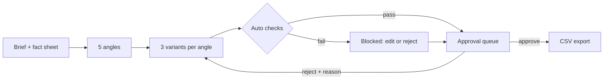

# Ad Creative Pipeline

AI generates, code checks, a human approves. A brief goes in; copy angles and ad variants come out in batches; every variant is checked against brand rules in plain code; a human approves, edits or rejects; only approved copy is exported.

**Live demo:** https://ad-creative-pipeline-orpin.vercel.app

## Flow



## The checks (plain code, `lib/checks.ts`)

| Rule | What it does |
| --- | --- |
| Banned words | Case-insensitive whole-word match on headline, primary text and CTA |
| Length limits | Headline 40, primary text 125, CTA 20 (configurable) |
| Claims vs fact sheet | Finds percentages, prices, time frames, "free", "guarantee" and similar, and blocks any not in the fact sheet |
| Duplicates | Word-overlap similarity of 70% or more against earlier variants |

Blocked variants never reach the review queue as approvable. Fix them with Edit (checks re-run on save) or reject them.

## Design decisions

- The model only sees the brief and the fact sheet, and is told never to invent offers, prices or stats.
- Model output is validated with zod. Invalid JSON gets one retry, then the next model in `OPENROUTER_MODELS`.
- Reject requires a reason. In live mode the reason is passed to the model as a constraint when regenerating.
- Every decision is logged with a timestamp. Editing resets a variant to "needs approval".
- Export contains approved variants only. Cells starting with `= + - @` are prefixed so spreadsheets never run them as formulas.
- The demo ships a cached sample batch (15 variants, 4 blocked on purpose), so it works without an API key or when a free model is rate-limited.

## Limits

- Copy plus the ad preview only. No image generation, no Meta publishing, no auth.
- Checks run in the browser. State lives in localStorage.
- The live-mode rate limit is in-memory, so it is per serverless instance.
- Cached-mode regeneration returns a prepared alternative and does not use the reject reason.

## Setup

```bash
npm install
cp .env.local.example .env.local   # add OPENROUTER_API_KEY
npm run dev
```

Free OpenRouter model IDs rotate. Pick from openrouter.ai/models (filter: free) and set `OPENROUTER_MODELS` as a comma-separated list, tried in order.

## Stack

Next.js (App Router), TypeScript, Tailwind CSS v4, zod, OpenRouter.

## Structure

```
app/api/generate/   batch and regenerate route (zod-validated, rate-limited)
components/         Workspace, VariantCard, BriefForm, AuditLog
lib/                checks, store (reducer), fixtures, llm failover, prompts, export
```